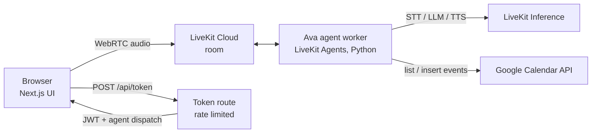

# Ava: Voice Scheduling Agent

A real-time voice agent that books appointments in Google Calendar. Talk to Ava in the browser. She works out what you need, checks the calendar, offers alternatives when a slot is taken, confirms the details, and creates the event. If you give an email, she sends you an invite.

Built on [LiveKit Agents](https://docs.livekit.io/agents) for real-time audio and the Google Calendar API for scheduling.

**Live demo:** https://voice-agent.nitishreddy.dev

## What it does

- **Understands natural speech:** "Can I get a haircut next Tuesday around two?" Relative dates are worked out from today's date and the calendar's time zone, which are injected into the prompt at the start of each call.
- **Manages the conversation:** asks one question at a time for anything missing (purpose, day, time, name). It honors spelled-out names, handles corrections, and confirms everything once before booking.
- **Checks real availability:** reads the calendar's busy times. It rejects times in the past or outside business hours (Mon–Fri, 9 AM–5 PM) and offers the nearest open slots.
- **Creates the event:** writes it to Google Calendar, optionally invites the caller by email, then says goodbye and hangs up.
- **Summarizes the call:** when the call ends, an LLM writes a short summary (request, outcome, details, follow-up, call length). It is appended to the booked event's description, so whoever opens the appointment sees what was said, and it is logged for calls that didn't book.

A typical call:

> **Ava:** Hi, this is Ava. How can I help?\
> **Caller:** I need a dental checkup tomorrow at 10.\
> **Ava:** 10 AM tomorrow is taken. I have 9 AM, 9:30, or 10:30. Would any of those work?\
> **Caller:** 10:30 works. I'm Sam.\
> **Ava:** Would you like a calendar invite by email?\
> **Caller:** No thanks.\
> **Ava:** So that's a dental checkup for Sam on Friday, October 23rd at 10:30 AM. Shall I book it?\
> **Caller:** Yes.\
> **Ava:** You're all set. Anything else? … Have a great day!

## Architecture



| Stage | Choice | Why |
|---|---|---|
| Speech to text | AssemblyAI Universal-Streaming | Streaming and low cost ($0.0025/min) |
| Turn detection | LiveKit turn detector + VAD | Knows when the caller has finished, even mid-sentence pauses; supports barge-in |
| LLM | GPT-4.1 mini | Reliable multi-turn tool calling at low latency |
| Text to speech | Cartesia Sonic 3 | Fastest first audio in my tests (see below) |
| Calendar | Google Calendar API v3, OAuth | Works with any Google account; a service account can't invite attendees without Workspace |

All models go through LiveKit Inference, so one LiveKit API key covers the whole voice pipeline. Each model can be swapped with an environment variable (see [Configuration](#configuration)).

### Measured latency

From a console session, user stops speaking → agent starts speaking:

| End of turn | LLM first token | TTS first audio | Total |
|---|---|---|---|
| 453 ms | 550 ms | 159 ms | **~1.5 s** |

TTS first audio for the same sentence, measured from the agent:

| Model | First audio |
|---|---|
| Cartesia Sonic 3 | 0.58 s |
| Deepgram Aura 2 | 1.16 s |
| Fish Audio S2.1 Pro (free tier) | 1.5–1.7 s |

Cartesia is the default. Fish Audio's free model costs nothing and is used for development testing.

## Design decisions

- **The agent never books without an explicit yes.** The prompt requires a single read-back before booking. As a second check, `book_appointment` re-validates availability, business hours and the past-time rule in code, because it can't rely on the LLM alone.
- **Tools return plain sentences, not errors.** Results like "That time is already booked. Nearest open times: …" can be spoken directly, so failures turn into a natural reply instead of a dead end.
- **Date math lives in the LLM; date validation lives in code.** The LLM turns "next Friday" into an ISO date using the date in its prompt. The tools parse, validate and reject anything malformed.
- **Calendar calls run off the event loop** (`asyncio.to_thread`), so a slow Google API response never stalls the audio pipeline.
- **The public demo is protected.** The token route limits requests per visitor and per day, and calls end after 5 minutes. Every call costs inference credits, so an open link can't drain them.

## Project layout

```
agent/
  agent.py             Ava: prompt, tools, session setup, call time limit
  calendar_client.py   Google Calendar: OAuth, busy times, free-slot search, event creation
  tests/               slot-logic unit tests + conversation tests
  Dockerfile           image for LiveKit Cloud
frontend/              Next.js voice UI (based on LiveKit's agent-starter-react)
  app/api/token/       issues LiveKit tokens, dispatches the agent, rate limits
```

## Running locally

**Requirements:** Python 3.13 with [uv](https://docs.astral.sh/uv/), Node 22+, a free [LiveKit Cloud](https://cloud.livekit.io) project, and a Google Cloud project.

### 1. Google Calendar access (one time)

1. Create a Google Cloud project and enable the **Google Calendar API**.
2. Set up the OAuth consent screen (External) and add your Google account as a test user.
3. Create an OAuth client of type **Desktop app** and save the JSON as `agent/credentials.json`.

### 2. Agent

```bash
cd agent
cp .env.example .env.local        # fill in LIVEKIT_URL, LIVEKIT_API_KEY, LIVEKIT_API_SECRET
uv sync
uv run python calendar_client.py  # opens a browser to sign in; saves token.json
uv run python agent.py console    # talk to Ava in the terminal
uv run python agent.py dev        # or: serve the web UI
```

### 3. Web UI

```bash
cd frontend
cp .env.example .env.local        # same LiveKit values, plus AGENT_NAME=scheduler
pnpm install
pnpm dev                          # http://localhost:3000
```

## Tests

```bash
cd agent
uv run pytest
```

- `test_slots.py` covers free-slot search, business hours and weekends. Runs offline.
- `test_conversation.py` runs Ava in text mode against the real LLM, with a fake calendar. It checks that she:
  - books only after the caller confirms, with the correct date and time,
  - offers alternatives when a slot is taken,
  - refuses times outside business hours.

  The checks combine assertions on the tool calls with an LLM judge on the replies. These tests need LiveKit credentials and are skipped without them. Like any LLM test, they can occasionally fail. In my runs they passed 9 out of 10 times.

## Deployment

- **Agent:** LiveKit Cloud (`lk agent create`, config in `agent/livekit.toml`). The Google token is passed in as the `GOOGLE_TOKEN_JSON` secret and is never baked into the image.
- **Web UI:** Next.js standalone build behind a Cloudflare Tunnel.

## Configuration

Agent environment variables (all optional except LiveKit credentials):

| Variable | Default | Purpose |
|---|---|---|
| `TIMEZONE` | `America/New_York` | Calendar time zone |
| `CALENDAR_ID` | `primary` | Which calendar to book into |
| `STT_MODEL` / `LLM_MODEL` / `TTS_MODEL` / `TTS_VOICE` | see `agent.py` | Swap models without code changes |
| `MAX_CALL_SECONDS` | `300` | Call time limit |

Web UI: `CALLS_PER_IP_PER_HOUR` (default 10) and `CALLS_PER_DAY` (default 40).

## Assumptions and limitations

- **One calendar.** Ava acts as the receptionist for a single calendar, such as a business or a provider. Callers are invited by email instead of having their own calendars modified.
- **Fixed business hours and 30-minute slots.** Both are constants in `calendar_client.py`.
- **No cancellation or rescheduling yet.** These would be the next tools to add, using the same pattern.
- **OAuth app in testing mode.** Google expires refresh tokens after 7 days for unpublished apps. `agent/scripts/refresh_google_token.sh` signs in again and updates the deployed agent in one step. Publishing the OAuth app removes the limit. If the token does lapse, Ava tells callers the calendar is unavailable instead of failing mid-call.
